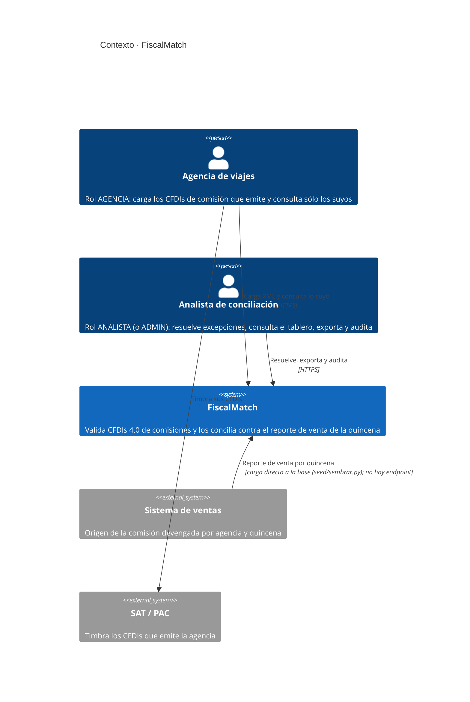
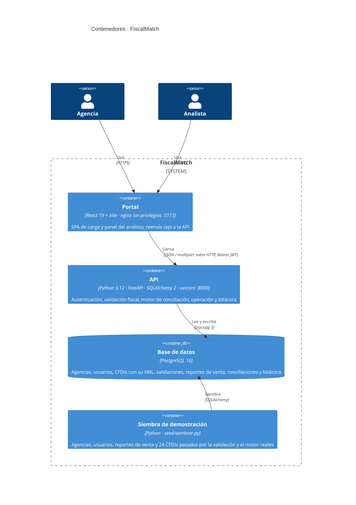
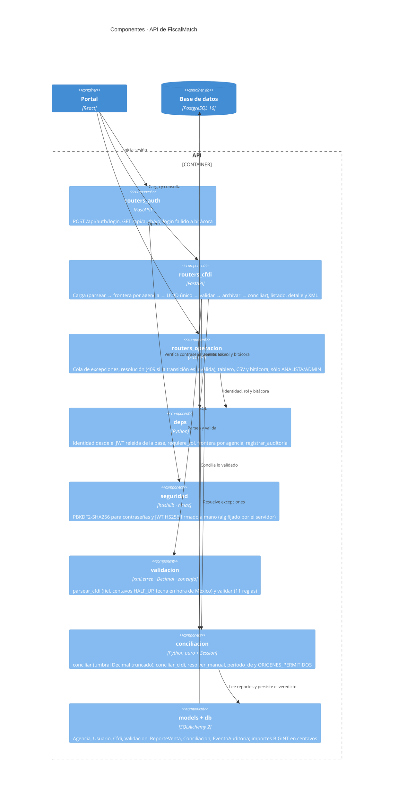
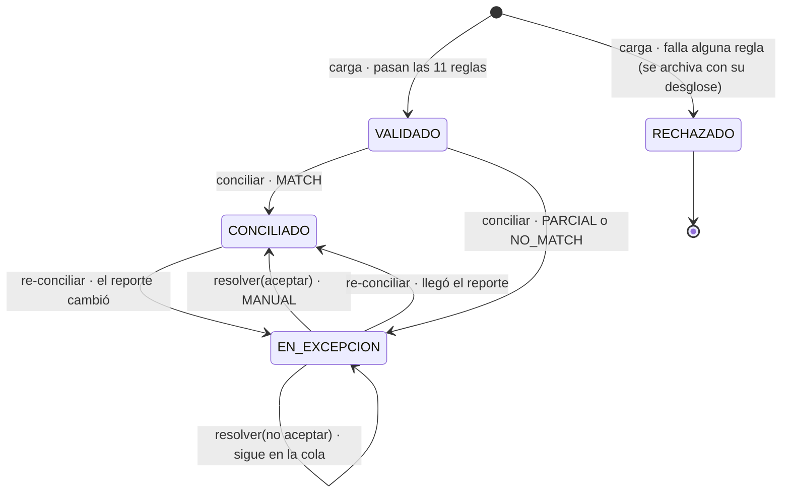
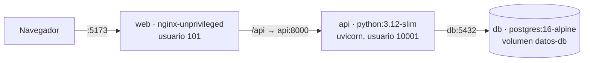

# Arquitectura · FiscalMatch (Tally)

Modelo C4: contexto → contenedores → componentes, más la máquina de estados del CFDI y el despliegue local.
Los diagramas son texto (Mermaid), se versionan con el código y describen lo que HAY, no lo deseado. Las
decisiones que explican la forma están en [`docs/adr/`](../adr/); las reglas de negocio y sus pruebas, en
[`docs/reglas.md`](../reglas.md); el contrato de la API, en [`docs/api/openapi.json`](../api/openapi.json).

## 1. Contexto

FiscalMatch **no consulta al SAT**: la regla CERTIFICADO_VIGENTE sólo revisa la forma del número de
certificado y lo declara como simulación. Los RFC, sellos y UUID de los ejemplos son sintéticos.

## 2. Contenedores

## 3. Componentes de la API

## 4. Máquina de estados del CFDI

Inválidas (prueba en `docs/reglas.md`, sección 6): conciliar un RECHAZADO o RECIBIDO, resolver algo que no
esté EN_EXCEPCION (la API responde 409 sin cambios ni bitácora). RECIBIDO existe en el enum pero la carga
dictamina en la misma transacción, así que nunca se persiste.

## 5. Despliegue

No hay despliegue en la nube (ni Vercel, ni Render, ni otro): la pila corre con `docker compose` y el CI
construye y arranca las mismas imágenes. Ver [`RUNBOOK.md`](../../RUNBOOK.md).

